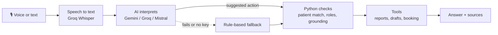

# 🦷 Viscan Dental Assistant

A voice-first assistant for dental clinics. A dentist can say *"Open Priya's latest OPG report"* or dictate *"Lower right third molar is horizontally impacted"*, and the assistant finds the right report or turns the dictation into a structured draft that's ready to review.

I built it as a proof of concept, with one rule in mind: **the AI understands the words, but plain Python makes the decisions.** It never guesses a patient, never invents a finding, and never books anything without a "yes".

> All patient data in `data/` is fictional. There is no real patient information in this repo.

---

## See it in action

```text
You:        Open Priya's latest OPG report
Assistant:  I found two patients named Priya: Priya Sharma (b. 1990) and Priya Shah (b. 1985). Which one?
You:        Priya Sharma
Assistant:  Priya Sharma's latest OPG is R002 from 2026-09-20...        [source: R002]
You:        Summarize her report
Assistant:  OPG R002 for Priya Sharma: occlusal caries on tooth 26...   [source: R002]
```

```text
Dictation:  "Lower right third molar is horizontally impacted. Possibly caries on the upper left first molar."

Finding 1   horizontally impacted   tooth 48 (FDI)   certainty: stated
Finding 2   caries                  tooth 26 (FDI)   certainty: uncertain
Status      DRAFT - requires clinician review
```

A full set of real API calls with their outputs is in [`docs/DEMO.md`](docs/DEMO.md).

---

## What it can do

| Feature | What happens |
|---|---|
| **Find a report** | Understands typed or spoken requests, handles typos ("pryia"), and picks the latest report of the right type |
| **Safe with similar names** | Two Priyas? It asks instead of guessing. No OPG for Kavya? It says so and lists what does exist |
| **Dictation to draft** | Turns speech into JSON findings with tooth numbers (FDI + Universal), where every finding quotes the words it came from |
| **No made-up findings** | Anything the model adds that wasn't said gets removed and flagged. Words like "maybe" mark a finding as uncertain |
| **Follow-up questions** | "Summarize her report" and "Does she have caries?" work without repeating the name, and every answer shows its source |
| **Scan booking** *(bonus)* | Finds a free slot, and books it only after you say "yes, confirm" |
| **Clinician sign-off** | Drafts can be edited, but only a dentist or radiologist can approve one |

---

## How it works



The AI's only job is to suggest an action, like "get Priya's latest OPG". Python then checks everything that matters: which patient it really is, whether the report exists, whether you're allowed to do this, and whether each finding is actually in the transcript. If an AI provider is down or there's no key, a rule-based parser takes over, so the app keeps working.

More detail is in [`docs/ARCHITECTURE.md`](docs/ARCHITECTURE.md).

---

## Run it in 2 minutes

```bash
git clone https://github.com/Mpasha17/Dental-assistant-poc.git
cd Dental-assistant-poc
python3 -m venv .venv && source .venv/bin/activate
pip install -r requirements.txt
cp .env.example .env
```

**Without any API keys** (rule-based mode with a typed transcript):

```bash
LLM_PROVIDER=rule STT_PROVIDER=mock uvicorn app.main:app --reload
```

**With free keys in `.env`** (full AI and voice):

```bash
LLM_PROVIDER=gemini STT_PROVIDER=groq uvicorn app.main:app --reload
```

Then open **http://127.0.0.1:8000**. You get a chat tab with a hold-to-talk mic button, plus a dictation tab. Prefer the terminal? Run `python cli.py --role dentist`.

**Run the tests** (55 tests, no internet needed):

```bash
make test
```

---

## Free providers only

No paid API is needed. Every provider here has a free tier:

| Provider | Used for | Get a key |
|---|---|---|
| **Google Gemini** | Main AI model (`gemini-3.1-flash-lite`) | [aistudio.google.com](https://aistudio.google.com/apikey) |
| **Groq** | Speech to text (`whisper-large-v3-turbo`) and backup AI (`openai/gpt-oss-120b`) | [console.groq.com](https://console.groq.com) |
| **Mistral** | Another backup AI (`mistral-small-latest`) | [console.mistral.ai](https://console.mistral.ai) |
| **faster-whisper** | Offline speech to text, no key needed | `pip install -r requirements-optional.txt` |

`GET /health` shows which providers are active and whether each key is set. It never shows the keys themselves.

<details>
<summary><b>All environment variables</b></summary>

| Variable | Default | What it does |
|---|---|---|
| `LLM_PROVIDER` | `gemini` | `gemini`, `groq`, `mistral`, or `rule` |
| `GEMINI_API_KEY` / `GEMINI_MODEL` | empty / `gemini-3.1-flash-lite` | Gemini settings |
| `GROQ_API_KEY` / `GROQ_MODEL` | empty / `openai/gpt-oss-120b` | Groq chat model (the key also covers Whisper) |
| `GROQ_WHISPER_MODEL` | `whisper-large-v3-turbo` | Groq speech model |
| `MISTRAL_API_KEY` / `MISTRAL_MODEL` | empty / `mistral-small-latest` | Mistral settings |
| `STT_PROVIDER` | `groq` | `groq`, `local`, or `mock` |
| `LOCAL_WHISPER_MODEL` | `base.en` | Offline Whisper model |
| `LLM_TIMEOUT_S` | `15` | Seconds before falling back to rules |
| `DEMO_DATE` | `2026-10-14` | The date used for "today" and "tomorrow" |
| `LOG_LEVEL` | `INFO` | Logging level |

Note that variables already set in your terminal override `.env`.
</details>

<details>
<summary><b>API endpoints</b></summary>

| Endpoint | Purpose |
|---|---|
| `POST /chat` | Send text, get an answer with sources |
| `POST /voice` | Send audio (webm/wav/mp3/m4a/ogg, up to 10 MB) |
| `POST /dictation`, `POST /dictation/audio` | Create a draft report |
| `PUT /draft/{id}` | Edit draft findings |
| `POST /draft/{id}/approve` | Approve a draft (dentist or radiologist only, via `X-User-Role`) |
| `GET /patients`, `GET /reports/{id}`, `GET /health` | Lookups and status |
</details>

---

## Privacy, cost and speed

- **Privacy:** the data is synthetic and logs show patient IDs, never names. Free AI tiers may keep prompts, so real patient data would need a self-hosted model or a provider agreement.
- **Access:** roles come from a request header for this demo. A real deployment would use proper login and an audit log.
- **Speed:** rule mode answers in milliseconds, and an AI call usually takes about 1-2 seconds. Timeouts and fallbacks keep the app responsive.
- **Cost:** $0. Everything runs on free tiers or locally.

---

## Project structure

```text
app/        FastAPI server, AI providers, speech to text, validation, tools
data/       Fictional patients, reports and appointment slots
static/     The web UI (chat + dictation)
tests/      55 automated tests
docs/       Architecture notes and a recorded API demo
cli.py      Terminal version of the assistant
```

---

## Known limitations

- Data, bookings and drafts live in memory, so a restart resets them.
- The rule-based fallback understands common phrasings, not everything a full AI model would.
- Grounding checks match words, so a valid paraphrase can sometimes be flagged.
- Uncertainty is detected from a fixed list of hedge words ("may", "possibly", "likely" and similar).
- Free tiers have rate limits. When a provider is busy, the app falls back to rules and says so in `provider_used`.

## What I'd build next

- Real login with role-based access, and an audit log of every action
- A database for reports, drafts and bookings
- An evaluation set of real spoken dictations with different accents
- Live transcription while the dentist speaks
- Integration with clinic imaging systems (PACS / FHIR)
